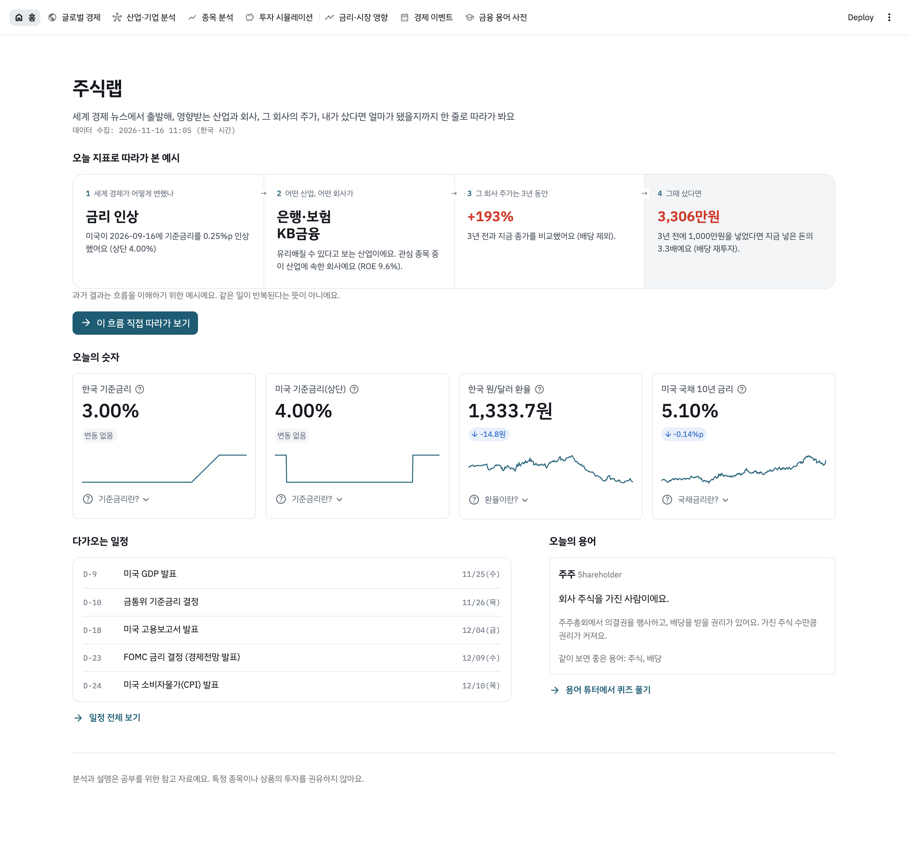
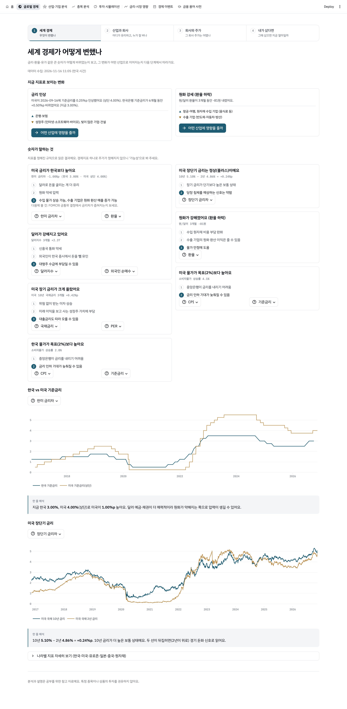
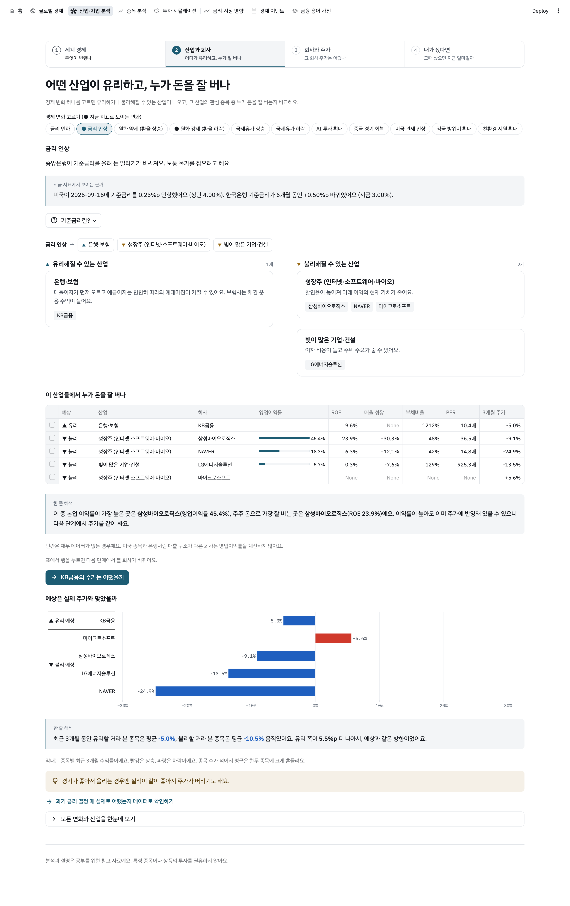
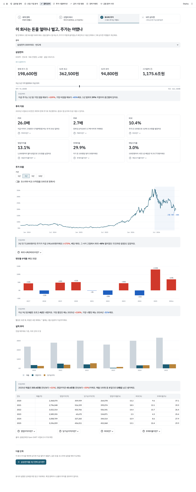
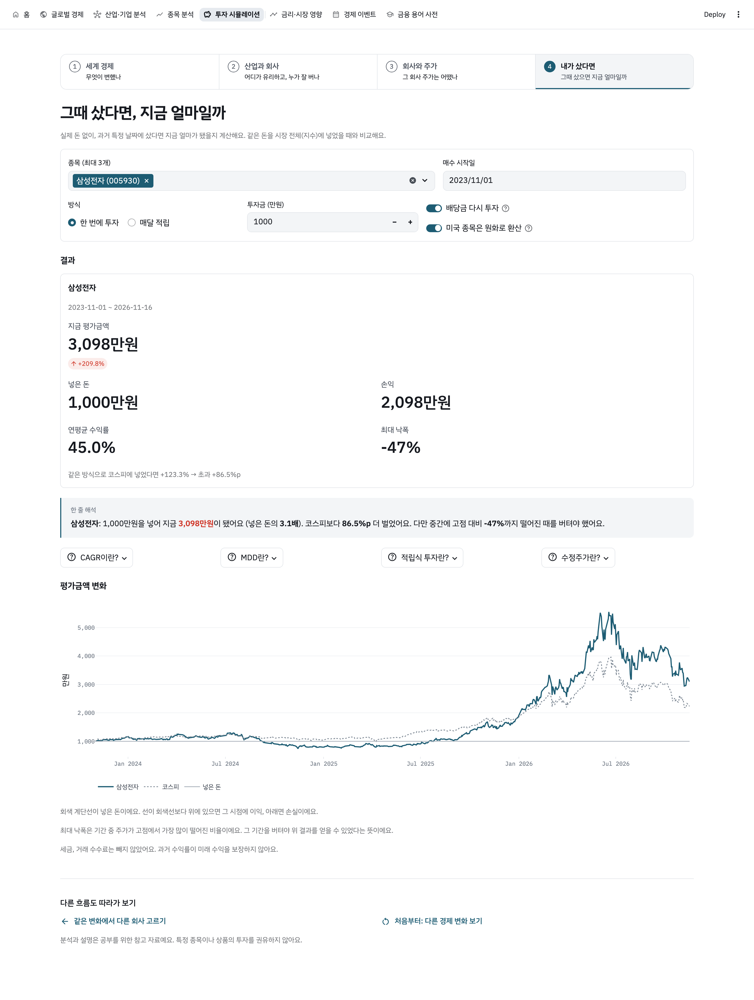
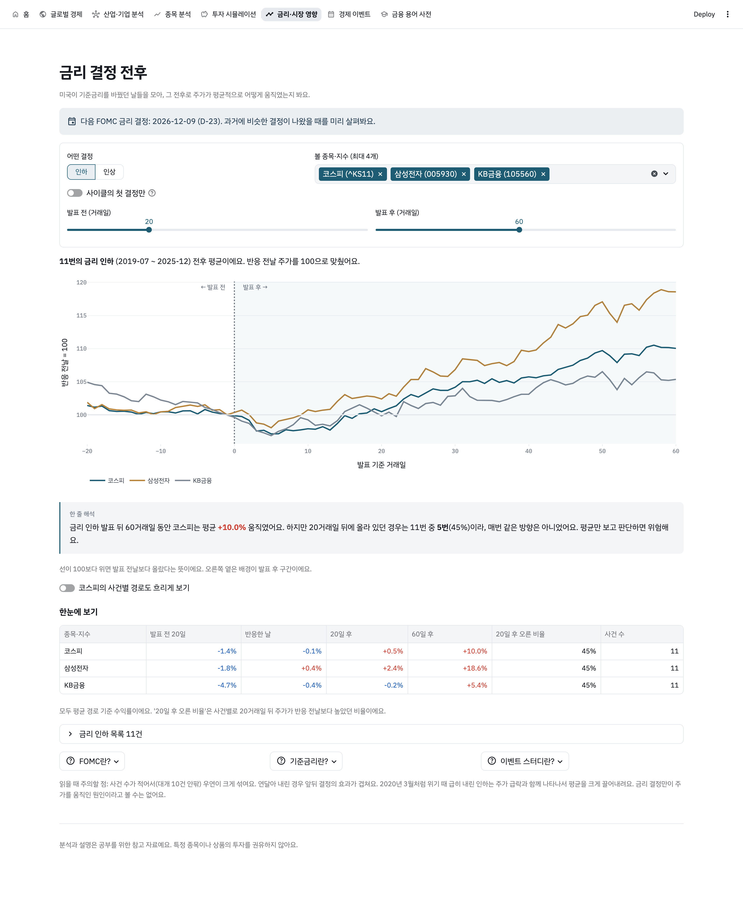

# 주식랩

- 미국 정책이 어떤 산업과 회사를 거쳐 내 주식에 왜, 얼마나 영향을 주는지 데이터로 한눈에 보려고 만든 주식·경제 분석 웹

## 화면

| 메뉴 | 하는 일 |
|---|---|
| 글로벌 경제 | 금리·환율·유가에서 감지된 변화와 숫자가 말하는 연결 고리, 한미 금리차, 미국 장단기 금리차, 6개 지역 지표 |
| 산업·기업 분석 | 경제 변화 11가지별로 유리·불리해질 수 있는 산업과 관련 종목의 영업이익률·ROE·매출 성장을 비교하고, 예상과 실제 주가 예측 |
| 종목 분석 | 투자 지표 6개와 쉬운 풀이, 1년 가격 범위에서 지금 위치, 주가 흐름과 최대 낙폭, 연도별 수익률, 실적 |
| 투자 시뮬레이션 | 한 번에 투자하거나 매달 적립했다면 지금 얼마인지 계산해요. 배당 재투자, 원화 환산, 코스피·S&P 500 비교, 연평균 수익률과 최대 낙폭 |
| 금리·시장 영향 | 미국이 금리를 바꿨던 날들 전후로 주가가 평균적으로 어떻게 움직였는지 |
| 경제 이벤트 | FOMC·금통위 금리 결정일, 미국 CPI·고용·GDP 발표일과 D-day |
| 금융 용어 사전 | 금융 용어의 뜻·계산식·예시·주의할 점 |


## 실행하기

streamlit run app.py

## 폴더 구조

```
app.py                  메뉴(상단 탭)와 페이지 연결
views/                  화면 하나당 파일 하나
  home.py  economy.py  calendar.py  tutor.py
lib/
  data.py               data/ 파일 읽기, 최신값·변화 계산
  insights.py           연결 고리 규칙 (한미 금리차, 장단기 금리차, 달러·원화·엔화, 물가)
  glossary.py           용어 사전, 어디서든 term("PER")로 물음표 버튼
  ui.py                 지표 카드, 차트, 일정 줄, 안내 문구
config/series.yaml      보여줄 지표 목록과 API 코드
data/
  glossary.yaml         용어 55개 (여기에 추가하면 바로 반영)
  events.yaml           FOMC·금통위 일정 (직접 관리)
  series/               collect.py가 만든 지표 CSV
  events_auto.csv       collect.py가 받은 미국 지표 발표일
scripts/collect.py      ECOS·FRED 수집
```

## UI 스크린샷






